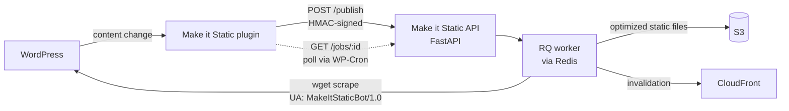

<p align="center">
  <picture>
    <source media="(prefers-color-scheme: dark)" srcset=".github/logo-dark.svg">
    
  </picture>
</p>

# Make it Static

A WordPress plugin that publishes your site as a fully static website via a self-hosted [Make it Static](https://github.com/driedel/make-it-static) service.

The plugin is a pure HTTP client: it watches for content changes, sends a signed publish request to the Make it Static API, and tracks the resulting job. The service scrapes your rendered site with wget, optimizes assets (bundles CSS/JS, compresses images and HTML, converts fonts), uploads everything to S3-compatible object storage, and optionally invalidates a CloudFront distribution.

## Architecture



- **Publish requests** are signed: `X-Signature` is the hex HMAC-SHA256 of the exact JSON request body, `X-Timestamp` is the current Unix time (accepted within ±300 seconds).
- **Fully asynchronous**: the API queues the job and returns immediately; the plugin polls job status every 30 seconds via WP-Cron. No webhooks.
- **One trigger = one full site re-scrape**, so every deploy is a consistent snapshot.

## Requirements

- PHP 8.1+
- WordPress 6.0+
- A running [Make it Static](https://github.com/driedel/make-it-static) service (FastAPI + RQ worker + Redis + S3-compatible storage), reachable over HTTP from WordPress
- The service's worker must be able to reach your WordPress site over HTTP
- Synchronized clocks on both sides (NTP) — signatures carry a timestamp valid for ±300 seconds

## Installation

1. Deploy the Make it Static service (see the [service repository](https://github.com/driedel/make-it-static)).
2. Install and activate this plugin.
3. Go to **Settings → Make it Static**, set the API base URL and HMAC secret, and click **Test connection**.

## Docker setup

WordPress and the Make it Static service must be able to talk to each other in both directions: the plugin calls the API, and the worker scrapes WordPress over HTTP. There are two common ways to wire this up.

### Option A: same Docker Compose project

Add the Make it Static services to your WordPress Compose project. Containers in one project resolve each other by service name, so the plugin's API base URL is simply `http://make-it-static-api:8000`:

```yaml
services:
  wordpress:
    image: wordpress:6.8-php8.3-apache
    # ... your usual WordPress config (volumes, env, db, etc.)

  make-it-static-api:
    image: ghcr.io/driedel/make-it-static-api:latest
    environment:
      MAKE_IT_STATIC_HMAC_SECRET: ${MAKE_IT_STATIC_HMAC_SECRET}
      REDIS_URL: redis://make-it-static-redis:6379/0
      # ... S3 / CloudFront settings per the service docs

  make-it-static-worker:
    image: ghcr.io/driedel/make-it-static-worker:latest
    environment:
      MAKE_IT_STATIC_HMAC_SECRET: ${MAKE_IT_STATIC_HMAC_SECRET}
      REDIS_URL: redis://make-it-static-redis:6379/0
      # ... S3 / CloudFront settings per the service docs

  make-it-static-redis:
    image: redis:7-alpine
```

Set the plugin's **API base URL** to `http://make-it-static-api:8000`.

### Option B: separate Compose projects on a shared external network

If the service runs in its own Compose project, join both projects to the same external network (the service project publishes a network named `make-it-static-network`):

```yaml
# In your WordPress project's docker-compose.yml
services:
  wordpress:
    image: wordpress:6.8-php8.3-apache
    networks:
      - default
      - make-it-static-network

networks:
  make-it-static-network:
    external: true
```

The plugin's **API base URL** is still `http://make-it-static-api:8000`, resolved over the shared network.

### Shared secret

The `MAKE_IT_STATIC_HMAC_SECRET` environment variable on the service side must be identical to the secret configured in the plugin. For better security, keep the secret out of the database by defining it as a PHP constant in `wp-config.php` — the plugin prefers the constant when it is defined and non-empty:

```php
define( 'MAKE_IT_STATIC_HMAC_SECRET', 'your-long-random-secret' );
```

### The worker must be able to reach WordPress

The worker scrapes your site over HTTP. From inside Docker, `https://example.com` may not resolve to your WordPress container. If WordPress is served by an internal web server (e.g. an nginx service named `site_nginx`), set the plugin's **Scrape URL base** setting to the internal address, e.g. `http://site_nginx`. The plugin then builds the URL it sends to the API from this base instead of the public `home_url()`.

### Clock synchronization

Signature timestamps are only accepted within a ±300-second window. Run NTP on all hosts; Docker containers inherit the host clock, so a drifting host clock breaks every publish request with a 401.

### Scraping caveats

- The service identifies itself with the user agent `MakeItStaticBot/1.0`. Do not block it in security/firewall plugins, rate limiters, or robots rules.
- Cache plugins must not serve the bot pages that were cached for logged-in users — otherwise the admin bar or personalized content leaks into the static site. Exclude the bot UA from logged-in cache variants.
- Every publish re-scrapes the **entire reachable site**, so jobs legitimately take minutes. The plugin debounces and coalesces triggers; let jobs finish rather than re-triggering.

## Settings reference

All settings live under **Settings → Make it Static** (stored in a single `mis_settings` option).

| Setting | Default | Description |
| --- | --- | --- |
| API base URL | `http://make-it-static-api:8000` | Base URL of the Make it Static service API. |
| HMAC secret | *(empty)* | Shared secret for request signing. The `MAKE_IT_STATIC_HMAC_SECRET` PHP constant in `wp-config.php` takes precedence when defined. |
| Scrape URL base | *(empty)* | Optional override for the URL sent to the service (e.g. an internal hostname like `http://site_nginx`). When empty, the site's home URL is used. |
| CloudFront distribution ID | *(empty)* | When set, the service creates an invalidation after upload. |
| Extra CDN domains | *(empty)* | One domain per line; additional CDN hostnames rewritten in the static output. The `home_url()` host is added automatically when it differs from the scrape base host, so absolute URLs stored in post content are downloaded and rewritten too. |
| Optimization options | all on | Toggle bundle CSS, bundle JS, compress images, compress HTML, convert fonts. |
| Post types | post, page | Which post types trigger a publish when published or updated. |
| Retry count | 3 | How many times a failed job is automatically re-published. |
| Debounce interval | 60 s | How long to wait after the last change before triggering a publish, so rapid edits coalesce. |

## How publishing works

- **Triggers**: publishing or updating a post of an enabled post type, and trashing or deleting content (which triggers a whole-site re-publish). A manual **Publish now** action is also available.
- **Debounce**: triggers don't publish immediately. They set a pending flag and schedule a single WP-Cron event `debounce_interval` seconds out; further triggers within that window just re-arm it.
- **Coalescing**: the service processes one job at a time per site, and the plugin enforces at most one active job. If changes arrive while a job is running, at most one follow-up publish is queued and starts after the active job finishes.
- **Job tracking**: each publish inserts a row into the `{prefix}_mis_jobs` table. A WP-Cron task polls every 30 seconds until the job reaches a terminal state (`finished`, `failed`, `stopped`, `canceled`) or its result has expired server-side (results are kept for about an hour).
- **Retries**: when a job fails and the retry budget is not exhausted, the plugin automatically re-POSTs the stored payload with a fresh signature. Manual retry and cancel actions are available on the job status screen.
- **Failure visibility**: the service intentionally returns only a generic "Job failed — check server logs" error. Inspect the worker logs, e.g. `docker compose logs worker` in the service deployment.

## Development

- **CI**: pull requests run [PHPCS](https://github.com/WordPress/WordPress-Coding-Standards) with the WordPress-Core standard and the WordPress.org [Plugin Check](https://wordpress.org/plugins/plugin-check/).
- **Deploy**: releases are pushed to the WordPress.org SVN repository with the 10up [WordPress Plugin Deploy](https://github.com/10up/action-wordpress-plugin-deploy) GitHub Action when a GitHub Release is published. Assets (screenshots, banners) live in `.wordpress-org/` and ship via the 10up [plugin asset update action](https://github.com/10up/action-wordpress-plugin-asset-update). Required repository secrets: `SVN_USERNAME` and `SVN_PASSWORD`.
- The `.distignore` file controls which files are excluded from the WordPress.org release package.

### Release checklist (SemVer)

This project follows [Semantic Versioning](https://semver.org/). For every release, keep all version references in sync:

1. Bump the `Version:` header in `make-it-static.php` (and any matching version constant).
2. Update `Stable tag:` in `readme.txt`.
3. Add the release entry to the `== Changelog ==` section of `readme.txt`.
4. Add the release entry to `CHANGELOG.md`.
5. Commit, tag the release (`git tag v1.0.1`), and push the tag.
6. Create a GitHub Release from the tag — the deploy action publishes to WordPress.org.

## License

GPL v2 or later. See [LICENSE](LICENSE).
